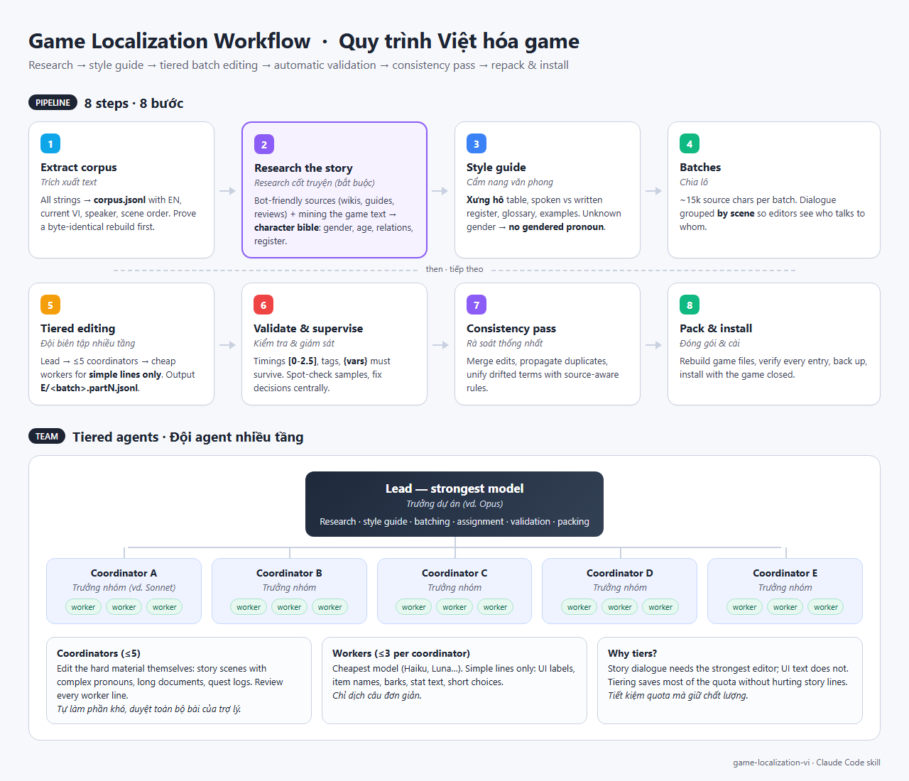

# game-localization-vi

**An Agent Skill for translating video games into Vietnamese — or re-editing an existing Vietnamese translation — with a research-first, tiered-agent workflow.**
**Agent Skill để Việt hóa game hoặc biên tập lại bản Việt hóa có sẵn, theo quy trình research trước, đội agent nhiều tầng.**

[English](#english) · [Tiếng Việt](#tiếng-việt)



<sub>Diagram source: [`docs/workflow.html`](docs/workflow.html) (plain HTML/CSS).</sub>

---

## English

### What it is
`game-localization-vi` is a **process**, not a phrasebook. It tells an AI agent *how* to run a game translation project end to end; it never decides *how a particular game should be translated*. Pronoun pairs, which names stay in the source language, the tone of documents, how a monster or an AI speaks — all of that comes from researching each game and is written into that game's own style guide.

Why: Vietnamese pronouns (xưng hô) encode age, gender, kinship, rank and attitude, and Vietnamese separates spoken and written register sharply. Translations fail when the editor does not know who is speaking to whom, or what kind of text a line is.

### Workflow
1. **Extract** every string into `corpus.jsonl` (source, current translation, speaker, scene order); prove the game files can be rebuilt identically.
2. **Research the story first** — bot-friendly sources plus the game's own text → a **character bible** (gender, age, relationships, register, pronoun pairs).
3. **Style guide for this game** — pronoun table, spoken vs written register, glossary, examples. **Unknown gender → no gendered pronoun.**
4. **Batches** of ~15k source characters; dialogue grouped **by scene**.
5. **Translate** — with subagents: lead → up to **5 coordinators** (hard lines) → up to **3 workers** each (cheapest model, simple lines only). Without subagents: one agent, batch by batch.
6. **Validate** — subtitle timings, tags and placeholders must survive; decisions are kept in shared files.
7. **Consistency pass**, then **rebuild, verify and install** (backups kept, game closed).

### Benefits: less quota, faster
Measured on a real 43,000-line project (98 batches). The first half ran entirely on the top model, one agent per batch; the second half used the tiered team (mid-tier coordinators + cheapest-model workers).

| | Top model only | Tiered workflow | Change |
|---|---|---|---|
| Tokens per 100k source characters | ~1.08 M (top model) | ~0.36 M (mid tier) + workers | **≈ −67% tokens** |
| API-equivalent cost per 100k source characters | $4.4 – 6.9 | $0.8 – 1.3 | **≈ −80% cost** |
| Parallel agents needed for the same throughput | 12 | 3 (+ small workers) | **−75%**, far fewer usage-limit stops |
| Wall-clock vs one agent doing batches one by one | ~20 h (estimated) | ~2.5–3 h | **≈ −85% time** |

Caveats: the tiered half had easier text (UI, documents) because the story dialogue was done first, so a fair estimate of the saving from tiering alone is **50–65% less quota**. Prices: API list prices at the time; subscription quota uses its own (unpublished) weighting.

### Compatibility
The skill follows the open **Agent Skills** format (`SKILL.md` + `references/` + `assets/` + `scripts/`) and coordinates everything through files, so it does not depend on one vendor's tools. How much of the team workflow you get depends on the harness:

| Harness | Skill folder (typical — check your version) | Team mode |
|---|---|---|
| Claude Code | `~/.claude/skills/` · `.claude/skills/` · plugin marketplace | full tiered team |
| Cursor (2.4+) | `.cursor/skills/` | tiered or two-level (subagents) |
| VS Code + GitHub Copilot | `.github/skills/` · `~/.copilot/skills/` | two-level or flat (custom agents) |
| OpenAI Codex | `.agents/skills/` · `~/.agents/skills/` | flat (several sessions) or single agent |
| Hermes Agent | `~/.hermes/skills/` | flat or single agent |
| Other Agent Skills harnesses | their skill folder | single agent at minimum |

Tested end to end on **Claude Code** only. Other harnesses support the format, but skill paths and subagent features change between versions — verify in your harness's docs. Without subagents the workflow still works, just sequentially.

### Install

**Claude Code — plugin marketplace (recommended)**
```text
/plugin marketplace add kann420/VH-Workflow-Skill
/plugin install game-localization-vi@viet-hoa-skills
```
or from a terminal:
```bash
claude plugin marketplace add kann420/VH-Workflow-Skill
claude plugin install game-localization-vi@viet-hoa-skills --scope user
```

**Any harness — npx (third-party tools, not by Anthropic)**
```bash
# Vercel Labs "skills" CLI — supports many agents; see `npx skills --help` for the -a values
npx skills add kann420/VH-Workflow-Skill
```
```bash
# degit: copy only the skill folder into your harness's skill directory
npx degit kann420/VH-Workflow-Skill/skills/game-localization-vi <skill-folder>/game-localization-vi
# e.g. ~/.claude/skills/game-localization-vi · .cursor/skills/game-localization-vi · .github/skills/game-localization-vi
```

**Any harness — manual copy**
Copy `skills/game-localization-vi/` into your harness's skill folder (table above). Windows: `~` is `%USERPROFILE%`. Restart the harness or open a new session afterwards.

### Requirements
- An agent harness that supports Agent Skills (or can be told to read `SKILL.md`), with file access and a shell.
- **Node.js 18+** for the bundled scripts.
- Web search/fetch helps the research step (otherwise provide links yourself).
- Subagents are optional (they make it faster and cheaper).
- Your own engine-specific extract/repack tools for the game (the skill explains what they must do and how to verify them).

### Usage
Describe the job, for example:
- "Việt hóa game *X*, text nằm trong `C:\Games\X\localization`"
- "The Vietnamese mod for *Y* has wrong pronouns and Google-Translate sentences, fix it"
- "Continue the localization batches from yesterday"

### Repository layout
```
.claude-plugin/          Claude Code plugin + marketplace manifests
docs/                    workflow diagram (HTML + PNG)
skills/game-localization-vi/
  SKILL.md               the workflow
  references/            research.md · orchestration.md · game-formats.md
  assets/                STYLE_GUIDE_template.md · AGENT_TASK.md · COORDINATOR.md · postfix.rules.template.js
  scripts/               build_batches · validate · split · vchunk · missing · show · status · finalize · postfix (Node.js)
```

### License
MIT — see [LICENSE](LICENSE). © 2026 VH Workflow Skills.

### Origin
Built while re-editing a 43,000-line Vietnamese fan translation of a story-heavy action game whose old translation was machine-translated and patched with regexes. Game-specific parts are intentionally **not** included — only the reusable process.

---

## Tiếng Việt

### Đây là gì
`game-localization-vi` là một **quy trình**, không phải bộ từ điển. Skill chỉ cho AI biết *cách* chạy một dự án Việt hóa từ đầu đến cuối; nó **không** quyết định *một game cụ thể phải dịch thế nào*. Cặp xưng hô, tên nào giữ tiếng gốc, giọng văn tài liệu, cách quái vật hay AI nói chuyện… đều lấy từ research của từng game và ghi vào cẩm nang riêng của game đó.

Lý do: xưng hô tiếng Việt mang theo tuổi tác, giới tính, quan hệ gia đình, cấp bậc và thái độ; tiếng Việt cũng phân biệt rõ văn nói và văn viết. Bản dịch hỏng khi người dịch không biết ai đang nói với ai, hay câu đó là loại văn bản gì.

### Quy trình
1. **Trích xuất** toàn bộ text vào `corpus.jsonl` (câu gốc, bản dịch hiện tại, người nói, thứ tự trong cảnh); chứng minh dựng lại file game giống hệt.
2. **Research cốt truyện trước tiên**: nguồn không chặn bot + text trong game → **hồ sơ nhân vật** (giới tính, tuổi, quan hệ, giọng nói, cặp xưng hô).
3. **Cẩm nang riêng cho game**: bảng xưng hô, văn nói và văn viết, thuật ngữ, ví dụ. **Không rõ giới tính thì không dùng đại từ có giới tính.**
4. **Chia lô** khoảng 15 nghìn ký tự gốc; thoại xếp **theo cảnh**.
5. **Dịch**: nếu có subagent thì trưởng dự án → tối đa **5 trưởng nhóm** (câu khó) → tối đa **3 trợ lý** mỗi nhóm (model rẻ nhất, chỉ câu dễ). Không có subagent thì một agent làm lần lượt từng lô.
6. **Kiểm tra**: mốc phụ đề, thẻ, biến phải còn nguyên; mọi quyết định lưu trong file dùng chung.
7. **Rà soát thống nhất**, rồi **đóng gói, kiểm tra và cài** (giữ bản sao lưu, thoát game trước khi cài).

### Lợi ích: tiết kiệm quota, dịch nhanh hơn
Đo trên một dự án thật 43.000 dòng (98 lô). Nửa đầu chạy toàn bằng model mạnh nhất, mỗi agent một lô; nửa sau dùng đội nhiều tầng (trưởng nhóm tầng giữa + trợ lý model rẻ nhất).

| | Chỉ dùng model mạnh nhất | Quy trình nhiều tầng | Thay đổi |
|---|---|---|---|
| Token cho mỗi 100 nghìn ký tự gốc | ~1,08 triệu (model mạnh) | ~0,36 triệu (tầng giữa) + trợ lý | **≈ −67% token** |
| Chi phí quy đổi giá API cho mỗi 100 nghìn ký tự gốc | $4,4 – 6,9 | $0,8 – 1,3 | **≈ −80% chi phí** |
| Số agent song song cần cho cùng tốc độ | 12 | 3 (+ trợ lý nhỏ) | **−75%**, ít bị chạm giới hạn quota hơn nhiều |
| Thời gian so với một agent làm lần lượt từng lô | ~20 giờ (ước tính) | ~2,5–3 giờ | **≈ −85% thời gian** |

Lưu ý: nửa sau có nội dung dễ hơn (giao diện, tài liệu) vì thoại cốt truyện đã làm trước, nên mức tiết kiệm công bằng nhờ riêng việc chia tầng là khoảng **50–65% quota**. Giá tính theo bảng giá API lúc đo; quota theo gói có cách quy đổi riêng (không công bố).

### Tương thích
Skill theo chuẩn mở **Agent Skills** (`SKILL.md` + `references/` + `assets/` + `scripts/`) và điều phối mọi thứ qua file, nên không phụ thuộc công cụ của một hãng nào. Mức độ dùng được đội agent tùy harness:

| Harness | Thư mục skill (thường gặp — kiểm tra theo phiên bản) | Chế độ đội |
|---|---|---|
| Claude Code | `~/.claude/skills/` · `.claude/skills/` · plugin marketplace | đội nhiều tầng đầy đủ |
| Cursor (2.4+) | `.cursor/skills/` | nhiều tầng hoặc hai tầng (subagent) |
| VS Code + GitHub Copilot | `.github/skills/` · `~/.copilot/skills/` | hai tầng hoặc một tầng (custom agent) |
| OpenAI Codex | `.agents/skills/` · `~/.agents/skills/` | một tầng (mở nhiều phiên) hoặc một agent |
| Hermes Agent | `~/.hermes/skills/` | một tầng hoặc một agent |
| Harness khác hỗ trợ Agent Skills | thư mục skill của nó | tối thiểu một agent |

Mới thử đầy đủ trên **Claude Code**. Các harness khác hỗ trợ định dạng này, nhưng đường dẫn và tính năng subagent thay đổi theo phiên bản, nên hãy kiểm tra tài liệu của harness. Không có subagent thì quy trình vẫn chạy, chỉ là làm tuần tự.

### Cài đặt

**Claude Code — plugin marketplace (khuyên dùng)**
```text
/plugin marketplace add kann420/VH-Workflow-Skill
/plugin install game-localization-vi@viet-hoa-skills
```
hoặc trong terminal:
```bash
claude plugin marketplace add kann420/VH-Workflow-Skill
claude plugin install game-localization-vi@viet-hoa-skills --scope user
```

**Mọi harness — npx (công cụ bên thứ ba, không phải của Anthropic)**
```bash
# CLI "skills" của Vercel Labs — hỗ trợ nhiều agent; xem `npx skills --help` để biết giá trị -a
npx skills add kann420/VH-Workflow-Skill
```
```bash
# degit: chỉ chép thư mục skill vào thư mục skill của harness
npx degit kann420/VH-Workflow-Skill/skills/game-localization-vi <thư-mục-skill>/game-localization-vi
# vd. ~/.claude/skills/game-localization-vi · .cursor/skills/game-localization-vi · .github/skills/game-localization-vi
```

**Mọi harness — chép tay**
Chép thư mục `skills/game-localization-vi/` vào thư mục skill của harness (bảng trên). Trên Windows, `~` là `%USERPROFILE%`. Cài xong thì khởi động lại harness hoặc mở phiên mới.

### Yêu cầu
- Harness hỗ trợ Agent Skills (hoặc có thể bảo nó đọc `SKILL.md`), có quyền đọc/ghi file và chạy lệnh.
- **Node.js 18+** để chạy các script kèm theo.
- Có công cụ tìm kiếm/đọc web thì bước research tốt hơn (không có thì bạn tự đưa link).
- Subagent là tùy chọn (có thì nhanh và rẻ hơn).
- Công cụ trích xuất/đóng gói riêng cho engine của game (skill hướng dẫn công cụ đó cần làm gì và kiểm tra ra sao).

### Cách dùng
Chỉ cần mô tả việc cần làm, ví dụ:
- "Việt hóa game *X*, text nằm trong `C:\Games\X\localization`"
- "Bản Việt hóa *Y* sai xưng hô, câu như Google Dịch, sửa giúp tôi"
- "Dịch tiếp các lô hôm qua"

### Cấu trúc repo
```
.claude-plugin/          khai báo plugin + marketplace cho Claude Code
docs/                    sơ đồ quy trình (HTML + PNG)
skills/game-localization-vi/
  SKILL.md               quy trình
  references/            research.md · orchestration.md · game-formats.md
  assets/                STYLE_GUIDE_template.md · AGENT_TASK.md · COORDINATOR.md · postfix.rules.template.js
  scripts/               build_batches · validate · split · vchunk · missing · show · status · finalize · postfix (Node.js)
```

### Giấy phép
MIT — xem [LICENSE](LICENSE). © 2026 VH Workflow Skills.

### Nguồn gốc
Skill được đúc kết khi biên tập lại một bản Việt hóa 43.000 dòng của một game hành động nặng cốt truyện, vốn dịch máy rồi vá bằng regex. Các phần riêng của game đó cố ý **không** đưa vào đây; chỉ giữ lại quy trình dùng lại được.
